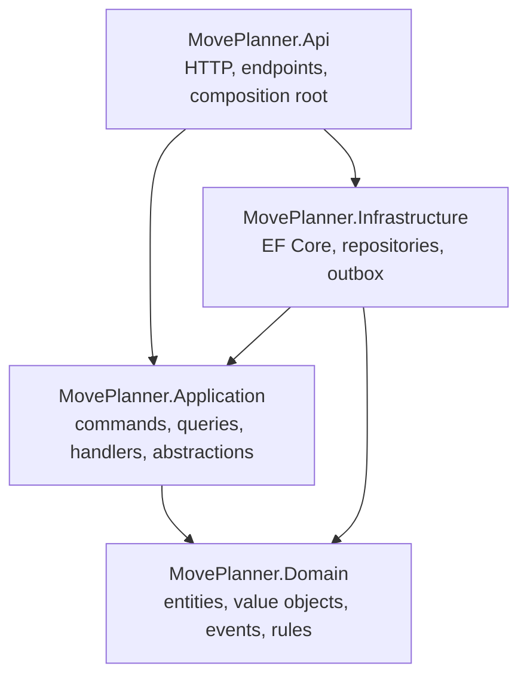

# MovePlanner

A web application for planning an international move: an ASP.NET Core API and an Angular front end. It is built as a set of modules that together help you organise a relocation, starting with a **job application tracker** for finding work in the destination country.

> **Status:** in development. The first module (job applications) is being designed and built. The roadmap below shows what is planned.

## Modules

| Module           | Status           | Description                                                                                    |
| ---------------- | ---------------- | ---------------------------------------------------------------------------------------------- |
| Job applications | In development   | Track applications from "saved" to offer or rejection, with status workflow and history        |
| Further modules  | Not designed yet | Other parts of a move, such as housing, paperwork or budget, will be added as separate modules |

The code is organised by module inside each project, so a new module can be added without changing existing ones.

## Job applications module

- Create, read, update and delete job applications
- Status workflow with enforced transitions: `Saved`, `Preparing`, `Applied`, `Interviewing`, `Offer`, `Rejected`, `Withdrawn`, `Archived`
- Automatic application date when an application is first marked as applied
- Full status history (timeline) per application, with optional notes
- Paging, filtering (status, company, role) and sorting on the list endpoint
- Dashboard queries: counts per status and recent activity
- Optimistic concurrency to prevent lost updates
- Domain events published through a transactional outbox, with retry and dead-letter handling

Platform features planned for all modules: authentication and per-user data isolation.

## Tech stack

**Backend**

- C# and ASP.NET Core (Minimal APIs)
- Entity Framework Core with PostgreSQL
- FluentValidation
- Serilog for structured logging
- OpenAPI with Scalar UI
- xUnit, FluentAssertions, Testcontainers and NetArchTest for tests

**Frontend** (in `src/MovePlanner.Client/`)

- Angular (standalone components, signals)
- PrimeNG for UI components, with a custom purple theme and dark mode
- Tailwind CSS
- NgRx Entity for state shape, Dexie (IndexedDB) for local persistence
- Vitest for unit tests

**Tooling**

- Docker and GitHub Actions

## Architecture

The solution is split into four projects following clean architecture. Dependencies point inwards, and the rules are enforced by architecture tests.



| Project                      | Responsibility                                                                                                                 |
| ---------------------------- | ------------------------------------------------------------------------------------------------------------------------------ |
| `MovePlanner.Domain`         | Aggregates, value objects, status rules, domain events. No framework dependencies.                                             |
| `MovePlanner.Application`    | Use cases (commands and queries), handlers, `Result<T>`, and abstractions such as repositories, unit of work and current user. |
| `MovePlanner.Infrastructure` | EF Core `DbContext`, mappings, migrations, repository implementations, outbox and its background processor.                    |
| `MovePlanner.Api`            | Minimal API endpoints, HTTP request and response types, validation, error mapping, and the composition root.                   |

Within each project, code is grouped by module. For example, the job applications module has a `JobApplications` folder in each of the four projects.

Key design points:

- **Handlers never touch HTTP.** Api request types carry the binding attributes and map to Application commands and queries with `ToCommand()` and `ToQuery()`.
- **Results instead of exceptions** for expected failures (validation, not found, conflict), mapped to `ProblemDetails` responses in Api.
- **Domain rules live in the aggregate.** Handlers load the aggregate, call a method such as `ChangeStatus`, and save.
- **Time comes from `TimeProvider`.** Direct use of `DateTime.UtcNow` is banned by an analyzer.
- **Outbox:** domain events are written to an outbox table in the same transaction as the data change, then dispatched by a background service.

Architecture decisions are recorded in [`decisions.md`](decisions.md).

### Client

The Angular app lives in `src/MovePlanner.Client/` and is organised by feature (`features/job-applications`, `features/dashboard`) on top of a shared `core` layer (layout, sidebar, topbar, breadcrumb, theme). Each feature has pages, models, stores and data access.

The client currently stores job applications locally in the browser (IndexedDB through Dexie) while the API is being built. Once the API exists, the data access layer will be switched to call it, and the models will follow the API contract.

## Repository layout

```
.
├── src/
│   ├── MovePlanner.Domain/
│   ├── MovePlanner.Application/
│   ├── MovePlanner.Infrastructure/
│   ├── MovePlanner.Api/
│   └── MovePlanner.Client/      # Angular app
│       ├── src/app/core/        # layout, theme, shared building blocks
│       ├── src/app/features/    # job-applications, dashboard
│       └── package.json
├── tests/
│   ├── MovePlanner.Domain.Tests/
│   ├── MovePlanner.Application.Tests/
│   ├── MovePlanner.Api.IntegrationTests/
│   └── MovePlanner.Architecture.Tests/
├── Directory.Build.props
├── Directory.Packages.props
├── BannedSymbols.txt
├── docker-compose.yml
├── .env.example
├── decisions.md
└── README.md
```

## Getting started

### Prerequisites

- [.NET SDK](https://dotnet.microsoft.com/download) (version pinned in `global.json`)
- [Docker](https://www.docker.com/) (for local PostgreSQL and for integration tests)
- The EF Core CLI: `dotnet tool install --global dotnet-ef`
- [Node.js](https://nodejs.org/) 22.22.3 or later, 24.15.0 or later, or 26+ (required by Angular 22), with npm, for the client

### Run locally (API)

1. Clone the repository:

   ```bash
   git clone https://github.com/Sveild/nordic-move-planner.git
   cd REPO
   ```

2. Create your local environment file and adjust the values if needed:

   ```bash
   cp .env.example .env
   ```

3. Start PostgreSQL:

   ```bash
   docker compose up -d
   ```

4. Store the connection string in user-secrets (never commit it):

   ```bash
   dotnet user-secrets set "ConnectionStrings:Default" "Host=localhost;Port=5432;Database=moveplanner;Username=...;Password=..." \
     --project src/MovePlanner.Api
   ```

5. Apply the database migrations:

   ```bash
   dotnet ef database update \
     --project src/MovePlanner.Infrastructure \
     --startup-project src/MovePlanner.Api
   ```

6. Run the API:

   ```bash
   dotnet run --project src/MovePlanner.Api
   ```

The API docs (Scalar UI) are available in Development at `/scalar`, and the health check at `/health`. Check the console output for the port.

### Run locally (client)

1. Install dependencies:

   ```bash
   cd src/MovePlanner.Client
   npm install
   ```

2. Provide the PrimeNG license key. It is read from an untracked `src/MovePlanner.Client/.env` file and written into the build by a small script, so it never lives in source control:

   ```
   PRIMENG_LICENSE=your-license-key
   ```

   See `src/MovePlanner.Client/.env.example` for the variable name.

3. Start the dev server:

   ```bash
   npm start
   ```

The app is served at `http://localhost:4200`. Use `npm start`, `npm run build` and `npm test` (not `ng serve` directly) so the environment script runs first.

To let the client call the API during development, add `http://localhost:4200` to the API's allowed CORS origins in configuration.

### Create a migration

```bash
dotnet ef migrations add MigrationName \
  --project src/MovePlanner.Infrastructure \
  --startup-project src/MovePlanner.Api
```

## API overview (job applications module)

| Method   | Route                                | Description                              |
| -------- | ------------------------------------ | ---------------------------------------- |
| `POST`   | `/job-applications`                  | Create a job application                 |
| `GET`    | `/job-applications`                  | List with paging, filtering and sorting  |
| `GET`    | `/job-applications/{id}`             | Get one job application                  |
| `PUT`    | `/job-applications/{id}`             | Update details (not the status)          |
| `POST`   | `/job-applications/{id}/status`      | Change the status, with an optional note |
| `GET`    | `/job-applications/{id}/history`     | Status history, newest first             |
| `DELETE` | `/job-applications/{id}`             | Delete a job application                 |
| `GET`    | `/job-applications/status-summary`   | Count per status                         |
| `GET`    | `/job-applications/recent-activity`  | Latest status changes                    |
| `GET`    | `/health`                            | Health check (application-wide)          |

Errors use `ProblemDetails`: `400` for validation failures, `404` when not found, `409` for invalid status transitions or concurrency conflicts.

> The route list reflects the planned design. The OpenAPI document is the source of truth once the endpoints exist.

## Testing

**API**

```bash
dotnet test
```

**Client**

```bash
cd src/MovePlanner.Client
npm test
```

| Project                | What it covers                                                                        |
| ---------------------- | ------------------------------------------------------------------------------------- |
| `Domain.Tests`         | Aggregate invariants and status transition rules                                      |
| `Application.Tests`    | Handlers against fake abstractions                                                    |
| `Api.IntegrationTests` | Full pipeline against a real PostgreSQL started with Testcontainers (Docker required) |
| `Architecture.Tests`   | Layer dependency rules                                                                |

## Code quality

Quality is enforced at build time:

- .NET analyzers at the strictest level, plus SonarAnalyzer, Meziantou.Analyzer and Roslynator
- Warnings are treated as errors
- `BannedSymbols.txt` bans APIs such as `DateTime.UtcNow` and `Task.Result`
- Formatting is checked with `dotnet format --verify-no-changes`
- Architecture tests enforce the project dependency rules

The client is formatted with Prettier (100 character lines, single quotes) and follows the `.editorconfig` rules.

Before opening a pull request:

```bash
# API
dotnet build -warnaserror
dotnet format --verify-no-changes
dotnet test

# Client
cd src/MovePlanner.Client
npx prettier --check .
npm test
npm run build
```

## Roadmap

| Milestone                                | Scope                                                                           |
| ---------------------------------------- | ------------------------------------------------------------------------------- |
| M1 - Foundation                          | Solution structure, building blocks, infrastructure, tooling, CI                |
| M2 - Domain and CRUD (MVP)               | Job application aggregate, create, get, list with paging, filtering and sorting |
| M3 - Update, status workflow, delete     | Update, concurrency, status changes and history, delete                         |
| M4 - Domain events, outbox and dashboard | Outbox, event handlers, dashboard queries                                       |
| M5 - Auth and production readiness       | Authentication, per-user data, Docker, Azure deployment, observability          |

The milestones above cover the API. The Angular client is tracked separately and will be connected to the API once the job applications endpoints are available. Progress is tracked in the repository's issues and milestones.

## Contributing

1. Pick an issue and create a branch from `main`.
2. Keep changes inside the right layer and the right module (see the architecture section). Client changes go under `src/MovePlanner.Client/src/app/features/<module>`.
3. Prefer fixing an analyzer warning over suppressing it. If you must suppress, add a justification.
4. Make sure the checks in the Code quality section pass, then open a pull request.
